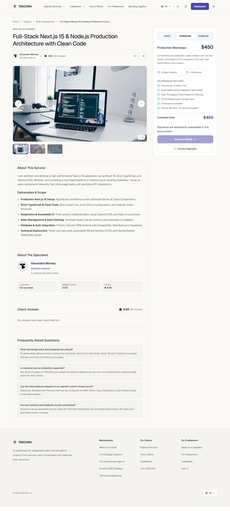
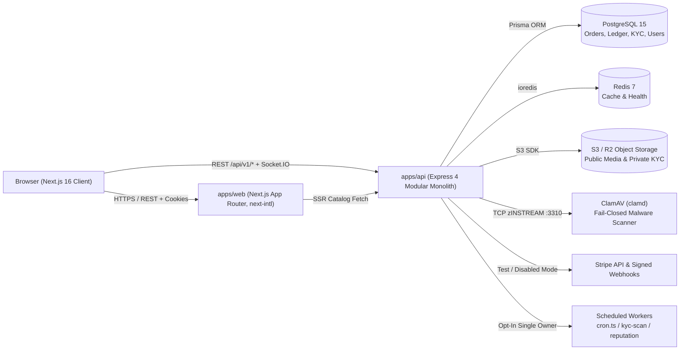
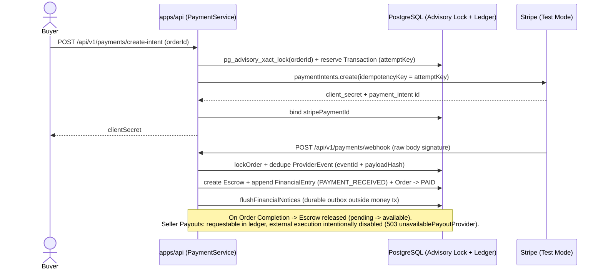

# TASCORA

[](https://github.com/ngophong123/TASCORA/actions/workflows/quality.yml)
[](https://github.com/ngophong123/TASCORA/actions/workflows/infrastructure-acceptance.yml)

**A full-stack freelance services marketplace monorepo built with Next.js 16, Express, TypeScript, Prisma, PostgreSQL, Redis, Socket.IO, and ClamAV.**

TASCORA implements service discovery, tiered package ordering, an append-only escrow ledger with Stripe payment-intent lifecycle hooks, real-time buyer-seller messaging, envelope-encrypted seller KYC workflows, and fail-closed malware scanning — verified across unit, API, security, Playwright E2E, disposable PostgreSQL, and live ClamAV CI suites.

> **Demo & Payment Safety Disclaimer:** There is **no verified public staging or production deployment yet**. Payment integration runs strictly in **Stripe Test Mode** or **Disabled Mode** (`PAYMENTS_PROVIDER=disabled`). **No real money is processed, and external seller payouts remain intentionally disabled** (`unavailablePayoutProvider`) until a dedicated payout provider adapter and compliance workflow are verified.

---

## Visual Overview

Captured from the rendered Next.js frontend with seeded non-production catalog data (no personal PII or live credentials):

| Marketplace Home (Desktop 1440px)                                               | Service Detail & Package Checkout Notice (Desktop 1440px)                   |
| ------------------------------------------------------------------------------- | --------------------------------------------------------------------------- |
|  |  |

| Service Catalog (Mobile 390px)                                                      | Authenticated Dashboard Screenshots                                                           |
| ----------------------------------------------------------------------------------- | --------------------------------------------------------------------------------------------- |
|  | Planned after hosted staging provisioning (see [STAGING_RUNBOOK.md](docs/STAGING_RUNBOOK.md)) |

---

## Verified Tech Stack

| Layer                     | Technologies Used in Repository                                                                                                                                                                                     |
| ------------------------- | ------------------------------------------------------------------------------------------------------------------------------------------------------------------------------------------------------------------- |
| **Frontend (`apps/web`)** | Next.js 16 (App Router, Turbopack), React 19, TypeScript, Tailwind CSS v4, next-intl (`en`/`vi`), `@base-ui/react`, Framer Motion, Lucide Icons, Socket.IO Client, `@stripe/stripe-js`                              |
| **Backend (`apps/api`)**  | Node.js 22 (CI) / >=20, Express 4, TypeScript, Zod, Pino structured logging, Helmet, CORS, `express-rate-limit`, Socket.IO, `bcryptjs`, JWT + HTTP-only cookies                                                     |
| **Data & Infra**          | Prisma 5 ORM, PostgreSQL 15, Redis 7 (`ioredis`), S3-compatible object storage (`@aws-sdk/client-s3`), ClamAV (`clamd` TCP `INSTREAM`), Stripe SDK (test/disabled modes)                                            |
| **Testing & Quality**     | Vitest (unit, API contract, security audit, disposable PostgreSQL integration), Supertest, Playwright + `@axe-core/playwright`, Lighthouse CI, ESLint (strict zero-warning on web), Prettier, Husky + `lint-staged` |

---

## Engineering Highlights (`PROBLEM -> SOLUTION -> EVIDENCE`)

### 1. Append-Only Financial Ledger, Idempotency & Advisory Order Locks

- **Problem:** Concurrent webhook retries, duplicate buyer checkout clicks, and interleaved refund/completion requests can double-credit seller balances or corrupt order states if balances are mutated in place.
- **Solution:** Financial state transitions serialize per order via PostgreSQL transaction-scoped advisory locks (`pg_advisory_xact_lock`), enforce explicit order state-machine transitions, deduplicate Stripe webhook payloads via SHA-256 hash checks in `ProviderEvent`, record integer-cent ledger movements in append-only `FinancialEntry` rows with unique `eventKey` constraints, and flush user notifications through a durable outbox outside the money transaction.
- **Evidence:** [apps/api/src/modules/financial/domain.ts](apps/api/src/modules/financial/domain.ts), [apps/api/src/modules/payment/payment.service.ts](apps/api/src/modules/payment/payment.service.ts), [apps/api/src/modules/financial/refund.service.ts](apps/api/src/modules/financial/refund.service.ts), [tests/database/financial-system.spec.ts](tests/database/financial-system.spec.ts), [docs/FINANCIAL_ARCHITECTURE.md](docs/FINANCIAL_ARCHITECTURE.md).

### 2. Envelope-Encrypted Seller KYC PII & Versioned HMAC Blind Index

- **Problem:** Storing seller identity document numbers and dates of birth in plaintext exposes regulated PII on database compromise, while naive hashing breaks key rotation and duplicate-document detection.
- **Solution:** Sensitive KYC fields are encrypted with AES-256-GCM using HKDF-SHA256 subkeys derived per key version (`v2:<keyId>:<iv>:<tag>:<ciphertext>`), while duplicate document detection uses a dedicated, key-separated HMAC-SHA256 blind index (`KYC_DOCUMENT_HMAC_KEY`) supporting active + rotated key lookups and an offline backfill worker (`kyc-hmac-migrate.ts`). Key material validation rejects weak entropy and key reuse at startup.
- **Evidence:** [apps/api/src/lib/kyc-crypto.ts](apps/api/src/lib/kyc-crypto.ts), [apps/api/src/lib/kyc-key.ts](apps/api/src/lib/kyc-key.ts), [apps/api/src/modules/kyc/kyc-hmac-migration.service.ts](apps/api/src/modules/kyc/kyc-hmac-migration.service.ts), [tests/security/kyc-security.spec.ts](tests/security/kyc-security.spec.ts), [tests/security/kyc-hmac-migration.spec.ts](tests/security/kyc-hmac-migration.spec.ts).

### 3. Fail-Closed Upload Isolation & Live ClamAV `INSTREAM` Scanning

- **Problem:** Allowing arbitrary uploaded URLs in chat, deliveries, or profiles can leak quarantined KYC identity documents across endpoints, and failing open when an antivirus daemon is unreachable silently promotes unscanned files.
- **Solution:** Uploads are tracked with explicit ownership and purpose separation (blocking KYC, orphaned, replaced, infected, or unregistered objects from non-KYC endpoints). `ClamdMalwareScanner` streams 64 KiB chunks over TCP `zINSTREAM` with backpressure handling, bounded concurrency, connect/idle/overall deadlines, and strict reply parsing. Unconfigured or unreachable scanners fail closed to `QUARANTINED` or `SCAN_FAILED` — never `VERIFIED_SAFE`.
- **Evidence:** [apps/api/src/modules/kyc/malware-scanner.ts](apps/api/src/modules/kyc/malware-scanner.ts), [apps/api/src/modules/upload/references.ts](apps/api/src/modules/upload/references.ts), [tests/security/clamd-scanner-hardening.spec.ts](tests/security/clamd-scanner-hardening.spec.ts), [tests/security/upload-chat-isolation.spec.ts](tests/security/upload-chat-isolation.spec.ts), [.github/workflows/infrastructure-acceptance.yml](.github/workflows/infrastructure-acceptance.yml).

### 4. Verified Origin Policy & Session-Revocation WebSocket Guardrails

- **Problem:** Wildcard CORS regexes or trusting client-supplied sender IDs on Socket.IO events can expose cookie-authenticated endpoints and private conversations to cross-origin spoofing or hijacked revoked sessions.
- **Solution:** CORS and Socket.IO handshakes enforce strict origin allowlists (with optional verified Vercel preview lookup with 2-second abort timeouts), derive message sender identity solely from the verified JWT session, check conversation membership before room joins/reads, and disconnect sockets immediately when a session is revoked or reaches absolute expiry.
- **Evidence:** [apps/api/src/lib/origin-policy.ts](apps/api/src/lib/origin-policy.ts), [apps/api/src/lib/socket.ts](apps/api/src/lib/socket.ts), [tests/security/preview-origin-policy.spec.ts](tests/security/preview-origin-policy.spec.ts), [tests/security/socket-wire.spec.ts](tests/security/socket-wire.spec.ts).

---

## System Architecture



---

## Payment, Escrow & Ledger Lifecycle



---

## Local Setup

### Prerequisites

- Node.js `>= 20.0.0` (CI runs Node.js `22`)
- `pnpm` (`packageManager: pnpm@12.4.1`)
- Docker (for PostgreSQL 15, Redis 7, and optional ClamAV)

### Quick Start

```bash
# 1. Install dependencies
pnpm install --frozen-lockfile

# 2. Start PostgreSQL, Redis, and ClamAV infrastructure
docker compose up -d postgres redis clamav

# 3. Copy environment template and fill local dev values
cp .env.example .env

# 4. Generate Prisma client and deploy schema migrations
pnpm db:generate
pnpm db:migrate:deploy

# 5. Run development servers (Web on :3200, API on :4000)
pnpm dev
```

### Verification Commands

```bash
# Typecheck + strict lint + unit tests
pnpm test:quick

# Individual suites
pnpm test:unit
pnpm test:api
pnpm test:security
pnpm run typecheck:tests:database

# Production build (API + Web)
NEXT_PUBLIC_API_URL=https://api.example.com NEXT_PUBLIC_WEB_URL=https://web.example.com pnpm build
```

> Disposable PostgreSQL integration tests (`vitest.database.config.mts`) and live ClamAV acceptance run automatically in GitHub Actions via [.github/workflows/infrastructure-acceptance.yml](.github/workflows/infrastructure-acceptance.yml).

---

## Documentation Index

- [System Architecture](docs/ARCHITECTURE.md)
- [Financial & Escrow Architecture](docs/FINANCIAL_ARCHITECTURE.md)
- [Implementation & Verification Status Matrix](docs/IMPLEMENTATION_STATUS.md)
- [Known Limitations](docs/KNOWN_LIMITATIONS.md)
- [Staging Runbook](docs/STAGING_RUNBOOK.md) & [Staging Readiness Report](docs/STAGING_READINESS_REPORT.md)
- [Architecture Decision Records (ADRs)](docs/adr/)
- [Employer 5-Minute Review Preview](docs/EMPLOYER_REVIEW_PREVIEW.md)

---

## Known Limitations (Summary)

- **External Seller Payouts Disabled:** `PayoutService.process` defaults to `unavailablePayoutProvider` (`503`) until an audited payout rail and reconciliation flow are implemented.
- **No Hosted Staging Verification Yet:** Staging configuration and runbooks are tested locally and in CI, but live cloud deployment (Render, Vercel, managed PostgreSQL/Redis/S3/ClamAV) remains a manual owner step.
- **Single-Replica Real-Time & Rate Limiting:** Socket.IO and `express-rate-limit` currently use in-memory state; horizontal multi-replica scaling requires Redis adapters (planned in a later milestone).
- **Monorepo Naming & Empty Packages:** Root package is named `taskora` (API `@taskora/api`, Web `web`) while the product brand is `TASCORA`; `packages/ui`, `packages/types`, and `packages/config` are currently stubs.

See [docs/KNOWN_LIMITATIONS.md](docs/KNOWN_LIMITATIONS.md) for the complete list.

---

## Roadmap

- **Batch 1 (Current):** Baseline audit, staging readiness guardrails, GitHub portfolio documentation, frontend audit & remediation.
- **Planned Next:** Hosted staging verification, distributed Redis adapters for Socket.IO & rate limiting, dedicated background worker process, observability/alerting, and further feature hardening.
