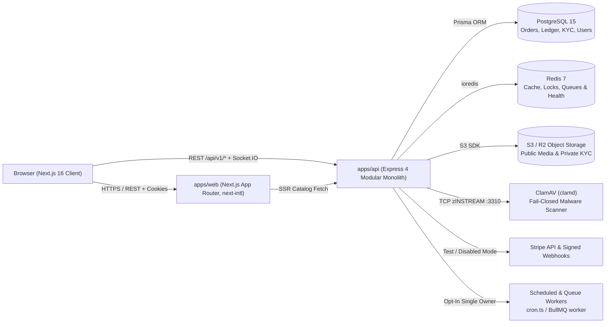
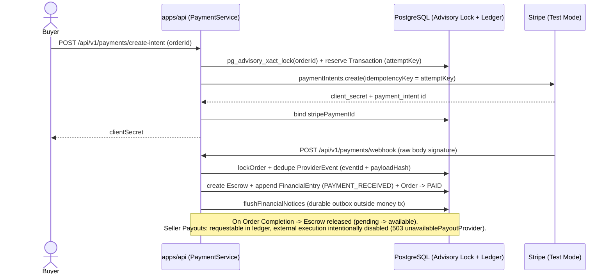

# TASCORA

[](https://github.com/ngophong123/TASCORA/actions/workflows/quality.yml)

**A full-stack freelance services marketplace monorepo built with Next.js 16, Express, TypeScript, Prisma, PostgreSQL, Redis, Socket.IO, BullMQ, and ClamAV.**

TASCORA implements service discovery, tiered package ordering, an append-only escrow ledger with Stripe test-mode payment and Connect lifecycle hooks, real-time buyer-seller messaging, envelope-encrypted seller KYC workflows, fail-closed malware scanning, Redis-backed distributed scaling primitives, ledger-backed KPI analytics, and hybrid semantic search with AI FinOps telemetry — verified across unit, API, security, Playwright E2E, Lighthouse CI, disposable PostgreSQL 15, Redis 7, and live ClamAV CI suites.

> **Scope & Payment Mode:** This repository is a demonstration application using sample/seed data and is not configured for real financial transactions. No hosted staging or live deployment has been verified. Payments run strictly in Stripe Test Mode or Disabled Mode (`PAYMENTS_PROVIDER=disabled`), and external seller payouts are disabled by default (`unavailablePayoutProvider`, `503`).

---

## Tech Stack

| Layer                     | Technologies Used in Repository                                                                                                                                                                                    |
| ------------------------- | ------------------------------------------------------------------------------------------------------------------------------------------------------------------------------------------------------------------ |
| **Frontend (`apps/web`)** | Next.js 16.4.6 (App Router, Turbopack), React 19, TypeScript, Tailwind CSS v4, `next-intl` (`en`/`vi`), `@base-ui/react`, Framer Motion, Lucide Icons, Socket.IO Client, `@stripe/stripe-js`                       |
| **Backend (`apps/api`)**  | Node.js 22 (CI) / >=20, Express 4 (21 domain modules), TypeScript, Zod, Pino structured logging, Helmet, CORS, `express-rate-limit` (`rate-limit-redis`), Socket.IO (`@socket.io/redis-adapter`), BullMQ, JWT      |
| **Data & Infra**          | Prisma 5 ORM, PostgreSQL 15, Redis 7 (`ioredis`), S3-compatible object storage (`@aws-sdk/client-s3`), ClamAV (`clamd` TCP `zINSTREAM`), Stripe SDK (Test / Disabled modes)                                        |
| **Testing & Quality**     | Vitest (unit, API contract, security/IDOR, disposable PostgreSQL integration), Supertest, Playwright + `@axe-core/playwright`, Lighthouse CI, ESLint (strict zero-warning on web), Prettier, Husky + `lint-staged` |

---

## Engineering Highlights

### 1. Append-Only Financial Ledger, Idempotency & Advisory Order Locks

Financial state transitions serialize per order via PostgreSQL transaction-scoped advisory locks (`pg_advisory_xact_lock`), enforce explicit order state-machine transitions, deduplicate Stripe webhook payloads via SHA-256 hash checks in `ProviderEvent`, record integer-cent movements in append-only `FinancialEntry` rows with unique `eventKey` constraints, and flush user notifications through a durable outbox outside the money transaction.

- **Key files:** [apps/api/src/modules/financial/domain.ts](apps/api/src/modules/financial/domain.ts), [apps/api/src/modules/payment/payment.service.ts](apps/api/src/modules/payment/payment.service.ts), [apps/api/src/modules/financial/refund.service.ts](apps/api/src/modules/financial/refund.service.ts), [apps/api/src/modules/financial/reconciliation.service.ts](apps/api/src/modules/financial/reconciliation.service.ts), [tests/database/financial-system.spec.ts](tests/database/financial-system.spec.ts), [docs/FINANCIAL_ARCHITECTURE.md](docs/FINANCIAL_ARCHITECTURE.md).

### 2. Envelope-Encrypted Seller KYC PII & Versioned HMAC Blind Index

Sensitive seller KYC fields are encrypted with AES-256-GCM using HKDF-SHA256 subkeys derived per key version (`v2:<keyId>:<iv>:<tag>:<ciphertext>`). Duplicate document detection uses a dedicated, key-separated HMAC-SHA256 blind index (`KYC_DOCUMENT_HMAC_KEY`) supporting active and rotated key lookups plus an offline backfill worker, and startup validation rejects weak entropy or key reuse.

- **Key files:** [apps/api/src/lib/kyc-crypto.ts](apps/api/src/lib/kyc-crypto.ts), [apps/api/src/lib/kyc-key.ts](apps/api/src/lib/kyc-key.ts), [apps/api/src/modules/kyc/kyc-hmac-migration.service.ts](apps/api/src/modules/kyc/kyc-hmac-migration.service.ts), [tests/security/kyc-security.spec.ts](tests/security/kyc-security.spec.ts), [tests/security/kyc-hmac-migration.spec.ts](tests/security/kyc-hmac-migration.spec.ts).

### 3. Fail-Closed Upload Isolation & Live ClamAV `zINSTREAM` Scanning

Uploads track explicit ownership and purpose separation to prevent KYC, orphaned, replaced, infected, or unregistered objects from being referenced in non-KYC endpoints. `ClamdMalwareScanner` streams 64 KiB chunks over TCP `zINSTREAM` with backpressure handling, bounded concurrency, connect/idle/overall deadlines, and strict reply parsing. Unconfigured or unreachable scanners fail closed to `QUARANTINED` or `SCAN_FAILED` rather than `VERIFIED_SAFE`.

- **Key files:** [apps/api/src/modules/kyc/malware-scanner.ts](apps/api/src/modules/kyc/malware-scanner.ts), [apps/api/src/modules/upload/references.ts](apps/api/src/modules/upload/references.ts), [tests/security/clamd-scanner-hardening.spec.ts](tests/security/clamd-scanner-hardening.spec.ts), [tests/security/upload-chat-isolation.spec.ts](tests/security/upload-chat-isolation.spec.ts), [.github/workflows/infrastructure-acceptance.yml](.github/workflows/infrastructure-acceptance.yml).

### 4. Verified Origin Policy, Distributed Scaling Primitives & WebSocket Guardrails

CORS and Socket.IO handshakes enforce strict origin allowlists (with optional verified Vercel preview lookups using 2-second abort timeouts), derive sender identity solely from verified JWT sessions, and disconnect sockets immediately on session revocation. Redis-backed primitives (`@socket.io/redis-adapter`, `rate-limit-redis` with explicit fail-open/fail-closed outage policies, BullMQ queues with a dedicated worker entrypoint, and Redis `SET NX PX` + Lua cron locks) support multi-instance deployment while preserving the modular monolith.

- **Key files:** [apps/api/src/lib/origin-policy.ts](apps/api/src/lib/origin-policy.ts), [apps/api/src/lib/socket.ts](apps/api/src/lib/socket.ts), [apps/api/src/lib/distributed-lock.ts](apps/api/src/lib/distributed-lock.ts), [apps/api/src/lib/rate-limit-store.ts](apps/api/src/lib/rate-limit-store.ts), [apps/api/src/workers/queues.ts](apps/api/src/workers/queues.ts), [tests/security/socket-wire.spec.ts](tests/security/socket-wire.spec.ts).

### 5. Automated Documentation Truthfulness Checks

`tests/unit/docs-truthfulness.spec.ts` runs in CI to validate that repository documentation matches the codebase: exact environment variable names (`PAYMENTS_PROVIDER`), active health probe routes (`/health` and `/health/live`), backend module directory count (`21 domain modules`), installed UI primitives (`@base-ui/react`), valid relative Markdown links, and prohibited terminology rules across public docs.

- **Key files:** [tests/unit/docs-truthfulness.spec.ts](tests/unit/docs-truthfulness.spec.ts), [docs/TASCORA_FINAL_ENGINEERING_REVIEW.md](docs/TASCORA_FINAL_ENGINEERING_REVIEW.md).

---

## System Architecture



---

## Payment, Escrow & Ledger Lifecycle



---

## Local Setup

### Prerequisites

- Node.js `>= 20.0.0` (CI runs Node.js `22`)
- `pnpm` (`packageManager: pnpm@12.4.1`)
- Docker (for PostgreSQL 15, Redis 7, and optional ClamAV)

### Quick Start

```bash
# 1. Install dependencies
pnpm install --frozen-lockfile

# 2. Start PostgreSQL, Redis, and ClamAV infrastructure
docker compose up -d postgres redis clamav

# 3. Copy environment template and fill local dev values
cp .env.example .env

# 4. Generate Prisma client and deploy schema migrations
pnpm db:generate
pnpm db:migrate:deploy

# 5. Run development servers (Web on :3200, API on :4000)
pnpm dev
```

See [apps/web/README.md](apps/web/README.md) for frontend-specific commands and workspace notes.

### Verification Commands & CI Coverage

```bash
# Typecheck + strict lint + unit tests
pnpm test:quick

# Individual suites
pnpm test:unit
pnpm test:api
pnpm test:security
pnpm run typecheck:tests:database

# Build API and Web workspaces
NEXT_PUBLIC_API_URL=https://api.example.com NEXT_PUBLIC_WEB_URL=https://web.example.com pnpm build
```

- **Main-branch Quality CI ([.github/workflows/quality.yml](.github/workflows/quality.yml)):** Runs on pushes to `main` and pull requests (`Lint & Typecheck`, `Playwright E2E Tests`, `Lighthouse CI Audits`). Verified green on `main` commit `9477e67` (Run `45601267339`).
- **Infrastructure Acceptance CI ([.github/workflows/infrastructure-acceptance.yml](.github/workflows/infrastructure-acceptance.yml)):** Runs on pull requests to `main` and manual `workflow_dispatch` against disposable `postgres:15-alpine`, `redis:7-alpine`, and live `clamav/clamav:stable` containers (verified green on PR `#23` Run `45600525400`, plus PRs `#18`, `#19`, `#21`, and `#22`). Because this workflow does not trigger on `push` to `main`, its badge is omitted from this README so badges reflect live `main` workflow state accurately.

---

## Documentation Index

- [System Architecture](docs/ARCHITECTURE.md)
- [Frontend Architecture](docs/FRONTEND_ARCHITECTURE.md) & [Web App README](apps/web/README.md)
- [Financial & Escrow Architecture](docs/FINANCIAL_ARCHITECTURE.md)
- [Implementation & Verification Status Matrix](docs/IMPLEMENTATION_STATUS.md)
- [Known Limitations](docs/KNOWN_LIMITATIONS.md)
- [Staging Runbook](docs/STAGING_RUNBOOK.md) & [Staging Readiness Report](docs/STAGING_READINESS_REPORT.md)
- [Architecture Decision Records (ADRs)](docs/adr/)
- [Codebase Overview](docs/EMPLOYER_REVIEW_PREVIEW.md)
- [Engineering Review](docs/TASCORA_FINAL_ENGINEERING_REVIEW.md)
- [Dependency Audit Record (2026-11-26)](docs/internal/audits/dependency-audit-2026-11-26.txt)

---

## Known Limitations (Summary)

- **Dependency Audit (2026-11-26, post-PR #23):** After upgrading Next.js to 16.4.6, `pnpm audit` reports 11 total advisories (0 Critical, 5 High, 5 Moderate, 1 Low; exit code 1) and `pnpm audit --prod` reports 2 advisories (0 Critical, 1 High, 1 Moderate; exit code 1). Under `--prod`, `zod@3.25.76` (High) is a direct API runtime dependency requiring a breaking v4 upgrade, while `minimatch@10.2.6` (Moderate) is reported only because `packages/eslint-config` declares `eslint-config-next` under `dependencies` rather than `devDependencies`, not because it is an application runtime dependency. The 9 additional findings in the full workspace audit come from dev/tooling transitive dependencies (`@lhci/cli`, `nodemon`, `typescript-eslint`). Full output is archived in [docs/internal/audits/dependency-audit-2026-11-26.txt](docs/internal/audits/dependency-audit-2026-11-26.txt).
- **Monorepo Naming & Stub Packages:** Root package is named `taskora` (API `@taskora/api`, Web `web`) while the product brand is `TASCORA`; `packages/ui`, `packages/types`, and `packages/config` remain stubs, and no `LICENSE` file has been added yet.

See [docs/KNOWN_LIMITATIONS.md](docs/KNOWN_LIMITATIONS.md) for the complete list, including payment/payout boundaries, hosted staging blockers, and product/AI scope limits.

---

## Roadmap Delivery Summary (Merged into `main`)

- **Batch 1 (Merged, PRs `#7`–`#12`):** Phase 0 baseline audit, staging readiness guardrails, repository documentation foundation, frontend audit and remediation, and automated docs-truthfulness regression suite.
- **Batch 2 & Hardening (Merged into `main` through `9477e67`, PRs `#13`–`#23`):** Hosted staging acceptance harness (Phase 4A.8, `#13`), marketplace E2E workflow map and IDOR suite (Phase 4B, `#14`), Stripe Connect test mode and read-only reconciliation (Phase 4C, `#15`), ledger-backed KPI analytics (Phase 4E, `#16`), hybrid semantic search and AI FinOps evaluation (Phase 4F, `#17`), Redis distributed scaling primitives (Phase 4D, `#18`), readiness tooling and secret scanning (Phase 4G, `#19`), master engineering review (Phase 5B, `#20`), API security hardening (WS5, `#21`), frontend route integrity and alert fixes (WS6, `#22`), and dependency remediation upgrading Next.js to `16.4.6` (WS1, `#23`).
