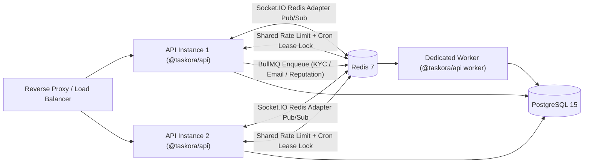

# TASCORA Distributed Systems Architecture (Phase 4D)

TASCORA retains its **Modular Monolith** architecture (single Express API codebase + dedicated background worker process sharing Redis and PostgreSQL) — intentionally avoiding unnecessary Kafka, RabbitMQ, or microservice sprawl while removing single-instance bottlenecks.

---

## 1. Horizontal Scaling Topology

---

## 2. Implemented Distributed Controls

| Capability                              | Implementation                                                                                                                                                                        | Policy / Trade-off                                                                                                                                                                                                                             |
| --------------------------------------- | ------------------------------------------------------------------------------------------------------------------------------------------------------------------------------------- | ---------------------------------------------------------------------------------------------------------------------------------------------------------------------------------------------------------------------------------------------- |
| **Multi-Instance Socket.IO**            | `@socket.io/redis-adapter` wired in `apps/api/src/lib/socket.ts` when `ENABLE_SOCKET_REDIS_ADAPTER=true`                                                                              | Synchronizes rooms (`conv_<id>`, `user_<id>`) across replicas via dedicated Redis pub/sub clients; retains in-memory adapter for unit/single-node tests.                                                                                       |
| **Shared Rate Limiting**                | `rate-limit-redis` + `apps/api/src/lib/rate-limit-store.ts`                                                                                                                           | Explicit outage policy: **fail-open** for general public API reads so catalog traffic stays available during brief Redis hiccups; configurable **fail-closed** (`RATE_LIMIT_AUTH_FAIL_CLOSED=true`) for `/api/v1/auth` brute-force protection. |
| **Async Background Queues**             | BullMQ queues (`tascora-kyc-scan`, `tascora-email-delivery`, `tascora-reputation-update`) in `apps/api/src/workers/queues.ts` + dedicated `apps/api/src/workers/worker.ts` entrypoint | 3 attempts, exponential backoff (`2000ms`), deterministic `jobId` deduplication, failed jobs preserved (`removeOnFail: { count: 200 }`) for dead-letter inspection, graceful `SIGTERM`/`SIGINT` shutdown.                                      |
| **Single-Owner Distributed Cron Lock**  | `apps/api/src/lib/distributed-lock.ts` (`SET NX PX` + owner-token Lua release) integrated in `apps/api/src/workers/cron.ts`                                                           | Prevents concurrent hourly financial auto-complete/outbox or daily reputation runs even if multiple API instances enable cron simultaneously.                                                                                                  |
| **Correlation ID & Redacted JSON Logs** | `apps/api/src/middlewares/correlationId.ts` + Pino `LOGGER_REDACT_PATHS` (`apps/api/src/lib/logger.ts`)                                                                               | Propagates `X-Correlation-Id` across HTTP and worker job payloads while redacting passwords, JWTs, cookies, and KYC PII.                                                                                                                       |

---

## 3. Financial Invariant Preservation

Phase 4D does **not** alter `FinancialEntry`, `Escrow`, `Payout`, `Refund`, or PostgreSQL per-order advisory locking (`pg_advisory_xact_lock`). All money transitions continue to execute strictly inside ACID PostgreSQL transactions.

---

## 4. Docker Compose Worker Entrypoint

`docker-compose.yml` now runs the real dedicated worker process (`pnpm --filter @taskora/api start:worker`) rather than a placeholder `tail -f /dev/null` command.
