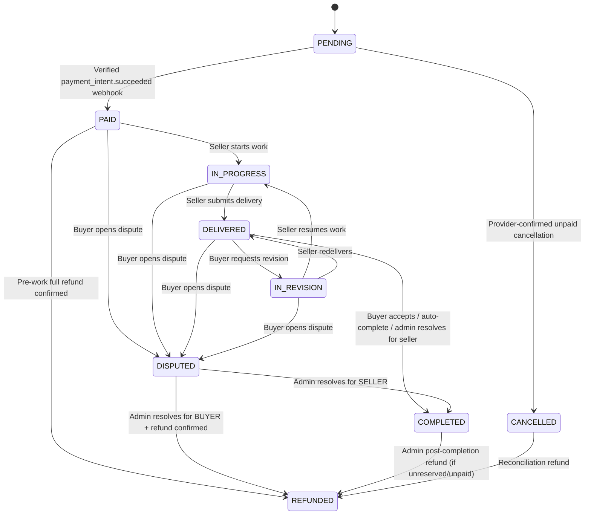

# TASCORA Financial & Escrow Architecture

> **Boundary Notice:** TASCORA processes **no real money**. Stripe integration is restricted to **Test Mode** (`sk_test_*` / `rk_test_*`) or **Disabled Mode** (`PAYMENTS_PROVIDER=disabled`). **External seller payouts are intentionally disabled** (`unavailablePayoutProvider`) and return `503 Service Unavailable`.

---

## 1. Core Financial Invariants

All monetary flows in `apps/api/src/modules/financial/` and `apps/api/src/modules/payment/` enforce five invariants:

1. **Integer-Cent Arithmetic:** Monetary calculations convert decimal values to integer minor units (USD cents) in `apps/api/src/modules/financial/money.ts` (`cents`, `money`, `split`) to eliminate floating-point rounding drift.
2. **Immutable Order Financial Snapshot:** When an order is created, `amount`, `currency`, `platformFeeBps`, and `purchaseSnapshot` (including `deliveryDays`) are persisted on the `Order` row. Later edits to a service package price cannot alter an existing order's accounting basis (`basis(order)`).
3. **Per-Order Transactional Serialization:** Every financial mutation runs inside `financialTx` (`prisma.$transaction` with `15s` maxWait/timeout) and acquires a PostgreSQL transaction-scoped advisory lock (`SELECT 1 FROM pg_advisory_xact_lock(hashtext(orderId))`) via `lockOrder(tx, orderId)` so concurrent webhooks, refunds, disputes, and payout requests execute sequentially per order.
4. **Append-Only Ledger (`FinancialEntry`):** Balances (`pending`, `available`, `reserved`, `paid`) are never overwritten directly. Every movement appends a `FinancialEntry` with a unique `eventKey` and delta columns (`pendingDelta`, `availableDelta`, `reservedDelta`, `paidDelta`, `feeDelta`). Current order or seller balances are derived by summing deltas (`balances(tx, orderId)`).
5. **Durable Notification Outbox:** `FinancialEntry` rows carry an optional `notifyUserId`. After the money transaction commits, `flushFinancialNotices(orderId)` upserts `Notification` rows keyed by `sourceKey: financial:<entryId>` outside the transaction so a notification failure never rolls back settled ledger writes.

---

## 2. Order & Escrow State Machine

Defined explicitly in `apps/api/src/modules/financial/domain.ts`:

Any transition outside `transitions[from]` throws `409 Conflict` (`transition(from, to)`).

---

## 3. Payment & Webhook Deduplication Flow

1. **Create Intent (`PaymentService.createPaymentIntent`):**
   - Verifies `assertProviderConfigured()` (blocks live keys in `NODE_ENV=test` or `APP_ENV=staging`; blocks all calls when `PAYMENTS_PROVIDER=disabled`).
   - Locks the order, validates `order.status === 'PENDING'`, validates Stripe USD bounds (`>= 50` cents, `<= 8` digits), and reuses any live non-cancelled `Transaction` attempt or creates one with a durable `attemptKey: payment:<orderId>:<uuid>`.
   - Calls `stripe.paymentIntents.create(..., { idempotencyKey: transaction.attemptKey })` and verifies returned amount, currency, and metadata before binding `stripePaymentId`.
2. **Webhook Settlement (`PaymentService.handleWebhookEvent`):**
   - Raw request body signature verified in `payment.controller.ts` before invoking the service.
   - Computes SHA-256 `payloadHash` of `event.data.object`.
   - Inside `lockOrder`, checks `ProviderEvent` by `event.id`:
     - Exact duplicate (`same type` + `same payloadHash`): returns idempotently without re-applying movements.
     - Conflicting payload for the same `event.id`: rejects with `400 Event ID payload mismatch`.
   - On `payment_intent.succeeded`, verifies `payment.amount_received === expected`, creates `Escrow`, appends `PAYMENT_RECEIVED` (`pendingDelta: +split.earning`, `feeDelta: +split.fee`), updates `Order` to `PAID` with computed `deliveryDate`, and inserts `ProviderEvent`.

---

## 4. Refunds & Internal Disputes

- **Refunds (`apps/api/src/modules/financial/refund.service.ts`):**
  - Buyer self-service refunds are restricted to full pre-work cancellation (`order.status === 'PAID'`); administrators may specify partial or full amounts during resolution.
  - Requests require a `16–128` character `requestKey` deduplicated via composite unique `(orderId, requestKey)`.
  - Refunds are blocked (`409`) whenever seller earnings are already `reserved` or `paid` (preventing negative seller balances without an explicit recovery flow).
  - Provider calls use Stripe idempotency key `refund:<refundId>`. Provider timeouts leave the refund in `PROCESSING` (keeping earnings frozen) rather than assuming failure.
  - On `succeeded`, `RefundService.apply` computes proportional fee and earning reversals via `split(gross - refunded, feeBps) - split(gross - total, feeBps)`, appends `REFUND` or `PARTIAL_REFUND`, and closes open disputes on full refund.
- **Disputes (`apps/api/src/modules/financial/dispute.service.ts`):**
  - Buyers can open a dispute on `PAID`, `IN_PROGRESS`, `IN_REVISION`, or `DELIVERED` orders while escrow is unreleased, freezing the order in `DISPUTED`.
  - Admins inspect bundled evidence (`DisputeService.evidence`) and resolve either for `SELLER` (completing order & releasing escrow) or `BUYER` (reserving a full remaining refund and setting dispute to `UNDER_REVIEW` until provider refund settles).

---

## 5. Seller Payout & Stripe Connect Boundary (Test Mode Only)

- **Seller Request (`PayoutService.request`):** When `PAYMENTS_PROVIDER` is enabled and an order is `COMPLETED` with released escrow, zero active refunds/disputes, and positive `available` balance, a seller can reserve available earnings into a `PENDING` `Payout` (`availableDelta: -amount`, `reservedDelta: +amount`) using a unique `requestKey`.
- **External Disbursement (`PayoutService.process`):** Defaults to `unavailablePayoutProvider` (`available: false`), which fails closed with `503 Payout provider validation required`. Even with an injected test double in integration tests, `PayoutService.process` enforces strict reference/amount/currency matching and leaves ambiguous timeouts in `PROCESSING` / `reserved` until reconciled.
- **Stripe Connect Test-Mode Flow (`StripeConnectService` in `apps/api/src/modules/financial/stripe-connect.service.ts`):** Exposes test-mode Express connected account creation (`/connect/account`), origin-validated onboarding links (`/connect/onboarding-link`), real KYC + dispute + seller eligibility checks (`/connect/eligibility`, keeping `eligibleForLivePayouts: false` unconditionally), idempotent `account.updated` / `charge.dispute.*` webhook handling, and an injectable test-mode transfer adapter that strictly rejects `sk_live_*`, `rk_live_*`, `livemode=true`, and `APP_ENV=production`.
- **Read-Only Financial Reconciliation (`reconciliation.service.ts`):** Admin reconciliation (`POST /api/v1/financial/admin/reconciliation/report`) compares internal transactions and ledger invariants against Stripe test records to detect missing/duplicate transactions and amount/currency/status/refund/ledger mismatches without mutating historical ledger entries. See [STRIPE_CONNECT_TESTING.md](STRIPE_CONNECT_TESTING.md).

---

## 6. Admin Financial Recovery Case Management

When an external provider chargeback or dispute (`charge.dispute.*`) impacts an order whose seller earnings were already `reserved` or `paid`, `DisputeService.handleProviderDisputeEvent` flags `MarketplaceDispute.recoveryRequired = true` and automatically ensures a linked `FinancialRecoveryCase` record exists inside the same locked transaction (`RecoveryCaseService.ensureCaseInTx`). See [ADR 005](adr/005-admin-financial-recovery-case-management.md).

- **Recovery Case Lifecycle:** Cases follow an investigation-only state machine defined in `apps/api/src/modules/financial/recovery-case.service.ts`:
  - `OPEN` -> `INVESTIGATING` or `AWAITING_EVIDENCE`
  - `INVESTIGATING` -> `AWAITING_EVIDENCE` or `PENDING_VERIFICATION`
  - `AWAITING_EVIDENCE` -> `INVESTIGATING` or `PENDING_VERIFICATION`
  - `PENDING_VERIFICATION` -> `INVESTIGATING` or `AWAITING_EVIDENCE`
  - There is intentionally **no** `RESOLVED`, `SETTLED`, or `CLOSED` status in this workflow because no verified settlement/clawback mechanism exists yet. Invalid transitions fail with `409 Conflict`.
- **Data Model:**
  - `FinancialRecoveryCase` (`financial_recovery_cases`): 1:1 unique link to `MarketplaceDispute` (`disputeId` unique) and `Order` (`orderId` unique), linked to `SellerProfile`, optional `assignedAdminId` (`User`), `status`, positive USD `recoveryAmount`, `currency`, and `lastActivityAt`. Enforced by PostgreSQL `CHECK` constraints (`status` domain, `recoveryAmount > 0 AND currency = 'usd'`) and `ON DELETE RESTRICT` foreign keys (`SET NULL` on `assignedAdminId`).
  - `FinancialRecoveryEvent` (`financial_recovery_events`): Append-only chronological investigation history (`CASE_OPENED`, `ASSIGNED`, `NOTE_ADDED`, `EVIDENCE_ATTACHED`, `EVIDENCE_REQUESTED`, `STATUS_CHANGED`) with optional unique `eventKey` deduplication and immutable PostgreSQL `BEFORE UPDATE OR DELETE` and `BEFORE TRUNCATE` triggers plus Prisma client immutability middleware (`apps/api/src/lib/prisma.ts`).
- **API Endpoints (`apps/api/src/modules/financial/financial.route.ts`):**
  - `GET /api/v1/financial/admin/recovery-cases`: Paginated queue with `status`, `assignedAdminId` (including `unassigned`), `sellerProfileId`, `search`, `sortBy` (`lastActivityAt`, `createdAt`, `recoveryAmount`), `sortOrder`, and integer-cent aggregate overview metrics.
  - `GET /api/v1/financial/admin/recovery-cases/:id`: Case detail including dispute metadata, order financial snapshot, integer-cent ledger balances (`pending`, `available`, `reserved`, `paid`, `fee`), chronological ledger entries, transactions, refunds, payouts, and append-only investigation timeline.
  - `POST /api/v1/financial/admin/recovery-cases/:id/events`: Appends `NOTE_ADDED`, `EVIDENCE_ATTACHED` (validated safe `upload:`, `ref:`, or `https://` reference), or `EVIDENCE_REQUESTED` with optional `idempotencyKey`.
  - `PATCH /api/v1/financial/admin/recovery-cases/:id/status`: Advances case status along permitted transitions with a mandatory reason and optional `idempotencyKey`.
  - `PATCH /api/v1/financial/admin/recovery-cases/:id/assign`: Assigns or unassigns an active `ADMIN` account (`assignedAdminId`) with optional `idempotencyKey`.
- **Authorization Rules:** Every endpoint requires `requireAuth`, `requireAdminRole`, and `requireFinancialAdmin` (which re-verifies the caller's live database row is `role === 'ADMIN'` and `status === 'ACTIVE'`). Non-admins, unauthenticated callers, and suspended admins are rejected (`401`/`403`). Responses expose only operational identifiers (admin name/id, seller display name/id, order/dispute IDs) and omit unnecessary user PII (such as buyer/seller emails or KYC identity data).
- **Investigation Workflow & Audit History:** All mutations acquire `lockOrder(tx, caseRow.orderId)` inside `financialTx`, append an immutable `FinancialRecoveryEvent`, update `FinancialRecoveryCase.lastActivityAt`, and write an append-only `AdminAuditLog` record (`RECOVERY_CASE_VIEWED`, `RECOVERY_CASE_ASSIGNED`, `RECOVERY_CASE_EVENT_ADDED`, `RECOVERY_CASE_STATUS_CHANGED`).
- **Financial Safety Boundaries & Payout Restrictions:** Admin investigation endpoints **never** write to `FinancialEntry`, **never** mutate `MarketplaceDispute.recoveryRequired`, **never** release `Escrow`, and **never** initiate payouts or refunds. Sellers with any `MarketplaceDispute.recoveryRequired = true` remain blocked from payout requests and Stripe Connect payout eligibility (`eligibleForLivePayouts: false`), and external seller payouts remain disabled (`unavailablePayoutProvider`, `503`).
- **Migration & Backfill Behavior:** Additive migration `prisma/migrations/20261127150000_financial_recovery_cases/migration.sql` creates both tables, indexes, foreign keys, `CHECK` constraints, append-only triggers, and performs an idempotent SQL backfill (`ON CONFLICT DO NOTHING`) that opens a `FinancialRecoveryCase` (`frc_<disputeId>`) and initial `CASE_OPENED` event for every pre-existing `MarketplaceDispute` row with `recoveryRequired = true`.
- **Operational Limitations:** This workflow provides visibility, assignment, structured evidence/notes, and auditability for manual recovery review. Clearing `recoveryRequired`, executing automated clawbacks, or posting compensating ledger entries requires a future verified settlement and reconciliation design.

---

## 7. Verification Evidence

- Unit tests: `tests/unit/financial-money.spec.ts`, `tests/unit/order-lifecycle.spec.ts`, `tests/unit/wallet-ledger.spec.ts`, `tests/unit/financial-reconciliation.spec.ts`, `tests/unit/financial-recovery-case.spec.ts`
- API & security tests: `tests/api/payment-lifecycle.spec.ts`, `tests/api/payment-provider-disabled.spec.ts`, `tests/api/stripe-connect-payouts.spec.ts`, `tests/api/financial-integrity-hardening.spec.ts`, `tests/api/financial-recovery-cases.spec.ts`, `tests/security/order-payment.spec.ts`, `tests/security/stripe-connect-safety.spec.ts`, `tests/security/admin-audit-integrity.spec.ts`
- Disposable PostgreSQL concurrency & migration tests (CI verified in `infrastructure-acceptance.yml`): `tests/database/financial-system.spec.ts`, `tests/database/disposable-postgres.spec.ts`
