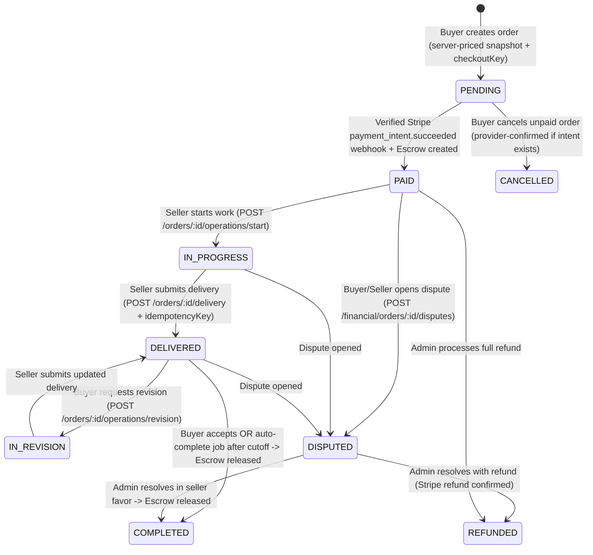

# TASCORA Marketplace End-to-End Workflow Map

This document maps all core TASCORA marketplace journeys across actors (`Guest`, `Buyer`, `Seller`, `Admin`), linking frontend App Router routes, backend Express API endpoints, Prisma models, authorization boundaries, and verified test coverage.

---

## 1. Order Lifecycle State Machine

---

## 2. Actor Workflow Matrix

| Actor          | User Journey                                       | Frontend Route (`/[locale]/...`)                                               | Backend API Endpoint(s)                                                                                                                              | Database Models                                                                  | Authorization Boundary                                                                                                          | Test Coverage                                                                                                                                        |
| -------------- | -------------------------------------------------- | ------------------------------------------------------------------------------ | ---------------------------------------------------------------------------------------------------------------------------------------------------- | -------------------------------------------------------------------------------- | ------------------------------------------------------------------------------------------------------------------------------- | ---------------------------------------------------------------------------------------------------------------------------------------------------- |
| Guest          | Browse home & featured catalog                     | `/`                                                                            | `GET /api/v1/services`, `GET /api/v1/marketplace/categories`                                                                                         | `Service`, `Category`, `SellerProfile`                                           | Public read; only `PUBLISHED` services of `APPROVED` + `ACTIVE` sellers                                                         | `tests/e2e/marketplace/navigation.spec.ts`, `tests/e2e/marketplace/workflow-journeys.spec.ts`                                                        |
| Guest          | Search, filter & inspect gig detail                | `/services`, `/services/[id]`                                                  | `GET /api/v1/services`, `GET /api/v1/services/:id`                                                                                                   | `Service`, `ServicePackage`, `Review`                                            | Public read; rejects unpublished/inactive sellers (`404`)                                                                       | `tests/e2e/marketplace/search-and-filter.spec.ts`, `tests/e2e/marketplace/gig-detail-and-order.spec.ts`                                              |
| Guest          | Browse categories & talent directory               | `/categories`, `/talent`, `/sellers/[id]`                                      | `GET /api/v1/marketplace/categories`, `GET /api/v1/marketplace/sellers/:id`                                                                          | `Category`, `SellerProfile`, `PortfolioItem`                                     | Public read; excludes non-approved/suspended sellers                                                                            | `tests/e2e/marketplace/live-marketplace.spec.ts`, `tests/api/marketplace-integration.spec.ts`                                                        |
| Guest          | Register, verify email, login, password reset      | `/register`, `/login`, `/verify-email`, `/forgot-password`, `/reset-password`  | `POST /api/v1/auth/register`, `/login`, `/refresh`, `/logout`, `/forgot-password`, `/reset-password`                                                 | `User`, `UserSession`, `RefreshToken`, `EmailVerification`, `PasswordResetToken` | Rate-limited auth router; `HttpOnly` refresh cookie rotation                                                                    | `tests/api/auth-lifecycle.spec.ts`, `tests/api/password-recovery.spec.ts`, `tests/e2e/auth/auth-flows.spec.ts`                                       |
| Buyer          | Select package & create server-priced order        | `/services/[id]`                                                               | `POST /api/v1/orders`                                                                                                                                | `Order`, `FinancialEntry`, `OrderActivity`                                       | `requireAuth`; blocks self-purchase (`403`), ignores client price/status tampering, enforces `checkoutKey` idempotency          | `tests/api/marketplace-e2e-journeys.spec.ts`, `tests/api/payment-lifecycle.spec.ts`, `tests/e2e/marketplace/gig-detail-and-order.spec.ts`            |
| Buyer          | Pay for order (Stripe Test Mode)                   | `/orders/[id]`                                                                 | `POST /api/v1/payments/create-intent`, `POST /api/v1/payments/webhook`                                                                               | `Transaction`, `Escrow`, `FinancialEntry`, `ProviderEvent`                       | `requireAuth` (buyer owns order); webhook signature + mode + replay validation; returns `503` when `PAYMENTS_PROVIDER=disabled` | `tests/api/payment-lifecycle.spec.ts`, `tests/api/payment-provider-disabled.spec.ts`, `tests/e2e/marketplace/payments-disabled.spec.ts`              |
| Buyer          | Cancel unpaid order                                | `/orders`, `/orders/[id]`                                                      | `POST /api/v1/orders/:id/operations/cancel`, `POST /api/v1/payments/:orderId/cancel`                                                                 | `Order`, `Transaction`, `FinancialEntry`                                         | Buyer ownership only; rejects cancellation of funded/non-`PENDING` orders (`409`)                                               | `tests/api/marketplace-e2e-journeys.spec.ts`, `tests/security/marketplace-idor-authorization.spec.ts`                                                |
| Buyer          | Request revision or accept delivery                | `/orders/[id]`                                                                 | `POST /api/v1/orders/:id/operations/revision`, `POST /api/v1/orders/:id/operations/accept`                                                           | `Order`, `Escrow`, `FinancialEntry`                                              | Buyer ownership only; valid only from `DELIVERED`; accepting releases escrow to seller available balance                        | `tests/api/marketplace-e2e-journeys.spec.ts`, `tests/security/marketplace-idor-authorization.spec.ts`                                                |
| Buyer          | Submit verified review after completion            | `/orders/[id]`                                                                 | `POST /api/v1/reviews`                                                                                                                               | `Review`, `Service`, `SellerProfile`                                             | Buyer of `COMPLETED` order only; blocks self-review, duplicate review (`409`), uncompleted order review (`409`)                 | `tests/api/marketplace-integration.spec.ts`, `tests/api/marketplace-e2e-journeys.spec.ts`                                                            |
| Buyer / Seller | Real-time & REST order messaging                   | `/messages`, `/orders/[id]`                                                    | `POST /api/v1/marketplace/conversations`, `POST /api/v1/messages`, Socket.IO events                                                                  | `Conversation`, `Message`, `Notification`                                        | Strictly conversation participants; rejects cross-owner upload references (`403`)                                               | `tests/api/marketplace-integration.spec.ts`, `tests/security/socket-authorization.spec.ts`, `tests/security/upload-chat-isolation.spec.ts`           |
| Buyer / Seller | Save favorites & view notifications                | `/dashboard`, `/services/[id]`                                                 | `POST/DELETE /api/v1/favorites`, `GET /api/v1/notifications`                                                                                         | `Favorite`, `Notification`                                                       | Authenticated user scoped strictly to own records                                                                               | `tests/api/api-contracts.spec.ts`                                                                                                                    |
| Seller         | Seller onboarding & KYC verification               | `/become-seller`, `/onboarding`, `/dashboard/kyc`                              | `POST /api/v1/onboarding/*`, `POST /api/v1/kyc/submit`, `POST /api/v1/uploads/kyc`                                                                   | `SellerProfile`, `IdentityVerification`, `UploadObject`                          | Authenticated owner; AES-256-GCM encrypted PII + HMAC blind index + ClamAV fail-closed quarantine                               | `tests/api/seller-kyc.spec.ts`, `tests/security/kyc-security.spec.ts`, `tests/e2e/auth/identity-kyc-flows.spec.ts`                                   |
| Seller         | Create draft gig, edit packages & manage sales     | `/dashboard`, `/dashboard/gigs`, `/dashboard/gigs/create`, `/dashboard/orders` | `POST /api/v1/services`, `PUT /api/v1/marketplace/services/:id/content`, `GET /api/v1/orders/my-sales`                                               | `Service`, `ServicePackage`, `Order`                                             | Owning seller profile only; outsiders receive `404`; price precision validated                                                  | `tests/api/marketplace-integration.spec.ts`, `tests/security/marketplace-idor-authorization.spec.ts`                                                 |
| Seller         | Start funded order & submit delivery               | `/orders/[id]`                                                                 | `POST /api/v1/orders/:id/operations/start`, `POST /api/v1/orders/:id/delivery`                                                                       | `Order`, `OrderDelivery`, `FinancialEntry`                                       | Owning seller only; requires funded unreleased escrow; delivery enforces `idempotencyKey` & owner upload prefix                 | `tests/api/marketplace-e2e-journeys.spec.ts`, `tests/security/marketplace-idor-authorization.spec.ts`                                                |
| Seller         | View earnings ledger & request payout              | `/dashboard/earnings`                                                          | `GET /api/v1/financial/orders/:id/ledger`, `POST /api/v1/financial/orders/:id/payouts`                                                               | `Payout`, `FinancialEntry`, `Escrow`                                             | Owning seller only; live external payout execution remains intentionally disabled (`503`)                                       | `tests/api/payment-lifecycle.spec.ts`                                                                                                                |
| Admin          | Moderate sellers, services, KYC, disputes, refunds | `/admin`                                                                       | `GET /api/v1/admin/review-queue`, `PUT /api/v1/admin/sellers/:id/review`, `PUT /api/v1/admin/services/:id/approve`, `POST /api/v1/financial/admin/*` | `AdminAuditLog`, `KycReviewHistory`, `MarketplaceDispute`, `Refund`              | Strict `ADMIN` role enforcement (`403` for `BUYER`/`SELLER`); immutable audit logging                                           | `tests/api/marketplace-integration.spec.ts`, `tests/security/admin-audit-integrity.spec.ts`, `tests/security/marketplace-idor-authorization.spec.ts` |

---

## 3. Known Unimplemented / Out-of-Scope Journeys (Honest Status)

- **Live Real-Money Payout Settlement:** `NOT IMPLEMENTED` by design (Stripe Connect test-mode workflow is scoped to Phase 4C; live money movement is strictly prohibited).
- **Seller Payout Bank Withdrawal UI:** `NOT IMPLEMENTED` (ledger/earnings visibility exists, external disbursement remains fail-closed).
- **Automated Multi-Currency FX Conversion:** `NOT IMPLEMENTED` (marketplace operates in single configured settlement currency `usd`).
